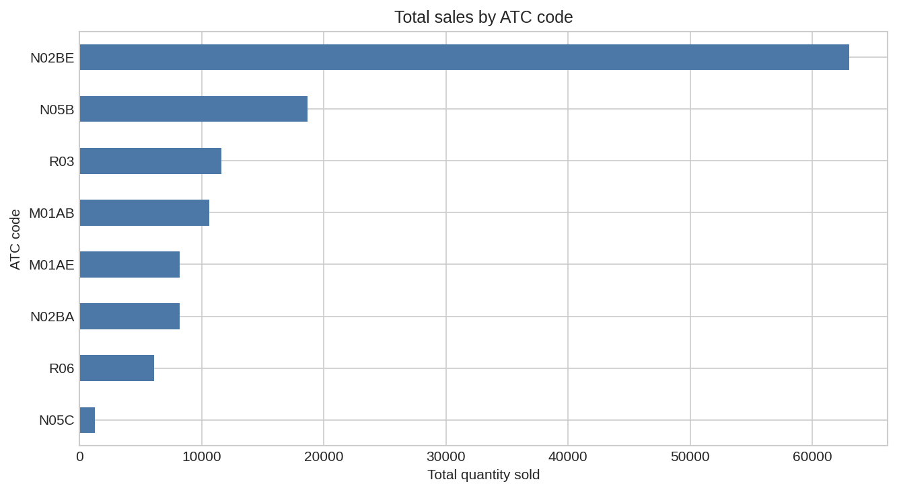
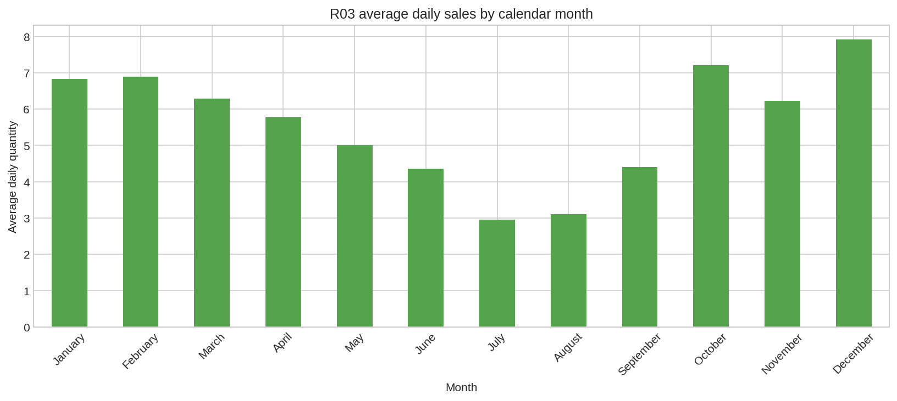

# analysing-pharma-sales-data

This project analyses historical pharmaceutical sales data using Python, Pandas, and Matplotlib. It was completed as part of the [Data Analyst Roadmap](https://roadmap.sh/projects/pharmaceutical-sales-data).

## Technologies

- Python 3
- Pandas
- Matplotlib
- Jupyter Notebook

## Project structure

```text
├── data/
│   └── salesdaily.csv
├── images/
│   └── sales_visualizations/
├── notebooks/
│   └── pharmaceutical_sales_analysis.ipynb
└── README.md
```

## Questions answered

- What are the total sales quantities for each drug category?
- Which drug categories have the highest total sales?
- Which three drugs have the highest sales in January 2015, July 2016, and September 2017?
- Which drug sold the most in 2017?
- Which drug category has the highest average daily sales?
- Are respiratory drugs (`R03`) sold more during specific months?

## Results

- `N02BE` has the highest total sales: **63,005.40 units**.
- `N02BE` sold the most in 2017: **9,258.80 units**.
- `N02BE` has the highest average daily sales: **29.92 units per day**.
- The top three categories were:
  - January 2015: `N02BE`, `N05B`, `R03`
  - July 2016: `N02BE`, `N05B`, `M01AB`
  - September 2017: `N02BE`, `N05B`, `R03`
- `R03` sales are highest in December and lowest in July based on average daily sales.

## Visualization





## How to run

Install the required libraries:

```bash
pip install pandas matplotlib jupyter
```

Open and run the notebook:

```bash
jupyter notebook notebooks/pharmaceutical_sales_analysis.ipynb
```

## Dataset

The dataset is available on [Kaggle](https://www.kaggle.com/datasets/milanzdravkovic/pharma-sales-data).
